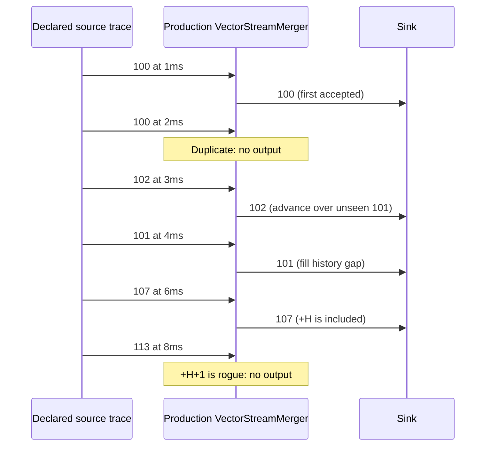
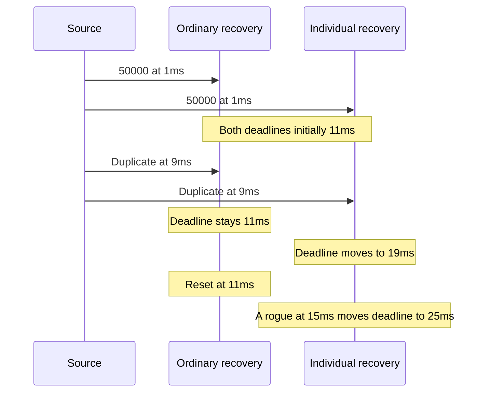

# Vector sequence recovery protocol tests

This document accompanies plan **VRA-2**, `redundancy: add configurable vector stream merger`, in [the contribution plan](../../../plan/pending/frer-vector-recovery.md). It explains the packet-level checks for IEEE 802.1CB-2017 base vector recovery, with the forward-window correction published in IEEE 802.1CBdb-2021 (maintenance item 0257).

## Requirement and original gap

IEEE 802.1CB-2017, 7.4.3.2-.4, specifies independent history/reference state, signed modulo-65536 comparisons, first-number acceptance after reset, duplicate/rogue rejection and timeout reloads. Section 7.4.3.6 advances history through unseen gaps. Section 7.5 applies recovery to one member stream and reloads its timer on numbered drops. Section 10.4.1.9 controls missing-sequence acceptance. Item 0257 changes the forward rogue test from delta >= H to delta > H; the negative test remains delta <= -H.

The existing StreamMerger checks membership in a bounded list of accepted numbers. It has no VRA acceptance window or recovery timeout. The original tree cannot instantiate VectorStreamMerger. Merely substituting the old merger also cannot satisfy these scenarios: an unseen rogue number would pass, and idle time would not clear remembered numbers. These are missing behaviors, not intentional expected failures.

VectorSequenceRecovery supplies sequence-position state and decisions. VectorStreamMerger commits that state once in handlePacketFiltered, before changing output tags or disposing of a rejected packet. Per-group OMNeT++ events implement rounded relative reset deadlines. Cumulative recovery signals and NED last-value statistics expose the counters without direct scalar recording in the model. The exact priority of simultaneous events is a documented model choice, and these tests exercise that choice rather than establish tick-phase equivalence to every hardware implementation.

## Fixture and observations

Each .test file declares an ordered trace of `(microseconds, input stream, sequence number, packet name)` in a NED parameter. FrameSource sends complete packets through the production merger's input gate. A negative sequence in the fixture omits SequenceNumberInd. The source contains no recovery algorithm. PassivePacketSink consumes the production output. The shared FrameSource.h contains only trace injection and packet/time comparisons.

The existing ProtocolTest framework attaches an observer after network initialization. Concurrent expectations check every input's identity, stream tag, sequence tag and absolute arrival time; cardinality guards check the total input/output counts. The main sequence asserts the next output packet's identity, renamed stream, sequence and exact time. An unexpected forwarded duplicate fails either the next-output assertion or the total count. A missing stimulus fails its input expectation, avoiding a vacuous silence result. No test invokes protected recovery methods or reads private state.

## Cases and expected traces

All times below are milliseconds. History H=5 unless stated. A zero timeout disables automatic expiration in the model.

| File | Stimulus and expected result | Requirement and failure before the addition |
| --- | --- | --- |
| VectorRecoveryDecisions.test | 100 passes; its copy drops; 102 and delayed 101 pass; repeated 101 drops; 107 (+H) passes; 102 (-H) and 113 (+H+1) drop; unseen 106 and next 108 pass. Six outputs. | 7.4.3.4 and item 0257. Membership-only filtering would admit unseen 113. |
| VectorRecoveryWraparound.test | 65534, 65535, 0 and 1 pass; old 65535 drops; 32769 is half-space rogue relative to 1; 2 passes. Five outputs. | Signed modular comparison in 7.4.3.4. The membership-only filter would admit the unseen half-space frame. |
| VectorRecoveryTimeout.test | Accept 50000 at 1; duplicate at 9 does not reload; accept new 0 at 11; duplicate at 12 drops; accepted 1 at 20 reloads; rogue at 29 does not reload; 50000 passes at 30 after reset. Four outputs. | 7.4.3.1-.4. The old filter has no expiration, and no rogue-window check. |
| VectorRecoveryIndividualTimeout.test | Accept 50000 at 1; duplicate at 9 reloads to 19; rogue 0 at 15 reloads to 25; rogue at 20 reloads to 30; 0 passes at 30. Two outputs. | 7.5 and 7.4.3.4. Missing either discard reload permits an unwanted early output. |
| VectorRecoveryTaglessAccept.test | Tagless at 1 passes without consuming first-number acceptance; 50000 at 2 passes; tagless at 10 reloads to 20; duplicates at 15/19 drop; 0 passes at 20. Four outputs. | 7.4.3.4, 10.4.1.9. The old merger expects a sequence indication and has no tagless/timer policy. |
| VectorRecoveryTaglessReject.test | Tagless at 1 drops; first numbered 50000 at 2 passes; tagless at 11 does not extend the deadline; 0 passes at 12. Two outputs. | 7.4.3.4, 10.4.1.9. Missing tagless control cannot implement this policy. |
| VectorRecoveryTickRounding.test | Timeout 11ms, 100 ticks/s: 50000 at 1 passes; 0 at 15 drops; 0 at 21 passes after the rounded 20ms interval. Two outputs. | Rounding expression in 7.4.3.4. No timer in the original module. |
| VectorRecoveryGroups.test | a/b share history, c is independent; identical numbers in c pass while b copies drop; unmapped x passes unchanged. Five outputs. | Independent state in 7.4.3.2 and member grouping in 7.4.2. Confirms integration with inherited mapping; group isolation alone was already possible in the old filter. |

## Recovery and timer diagrams





The first diagram is an excerpt of Decisions; the table supplies its intervening duplicate/lower-boundary/unseen-old/next stimuli. The second compares the shared initial portion of the two timeout cases; their subsequent stimuli differ as listed in the table.

## Commands and execution evidence

From a configured OMNeT++ environment, build fresh matching INET and support libraries before using --no-build:

```sh
make MODE=debug -j4
make -C tests/protocol/lib MODE=debug -j4
inet_run_protocol_tests -p inet -m debug --no-build --no-concurrent -w '^tests/protocol/frer$' -f 'VectorRecovery.*\.test$'
```

Repeat in release after matching builds. The convenience command `bash tests/run-vector-recovery-tests.sh` selects these eight tests, two core tests, eleven module tests, four network scenarios and existing FRER fingerprints, in both modes. It saves selected test names and a source-content manifest with the results. Do not interpret a generated test, successful compilation or dry selection as executed runtime evidence. Results are not embedded here; record actual run artifacts in the PR description.

## Coverage limits and modeling choices

These tests begin at the decoded sequence/stream indication boundary. They do not establish R-tag encoding, stream identification, physical-path independence, latent error detection, MRA, management interfaces or full IEEE 802.1CB conformance. The unit/module suites add exhaustive arithmetic, loss accounting, pure-query/pull behavior, mutable groups, zero-timeout behavior and invalid-setting checks. Constant timer tests use integer microsecond stimuli and explicit model ordering; they do not establish a continuously ticking clock's phase. Module scalars are aggregate diagnostics, not standard per-port/per-stream management tables. Accepted tagless packets and timer expiration are checked through packet behavior rather than internal counters.

The standard text remains external to the repository. The published window-correction status is documented in [IEEE maintenance item 0257](https://www.802-1.org/items/370), with the [accepted explanation](https://www.ieee802.org/1/files/public/docs2020/maint-varga-257-FRER-recovery-window-0320-v01.pdf). The parameter and scope mapping is in the VectorStreamMerger NED documentation and user's guide.
